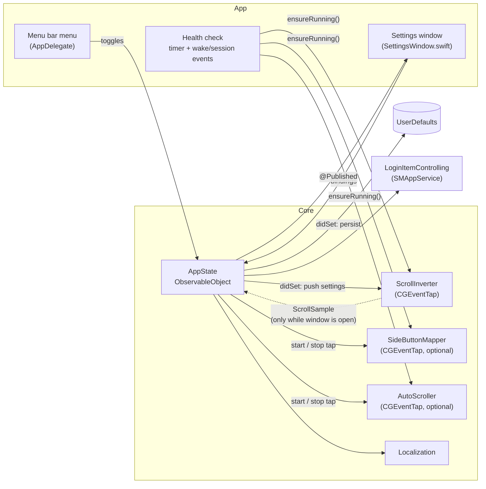
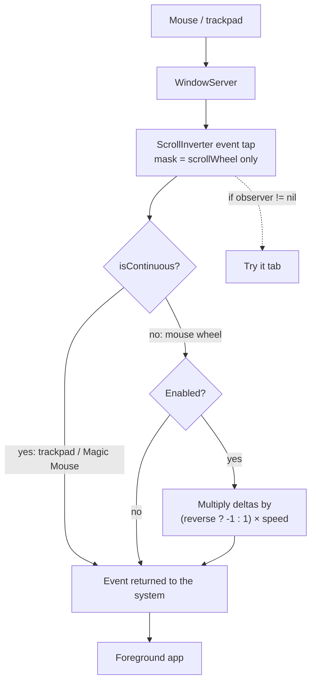
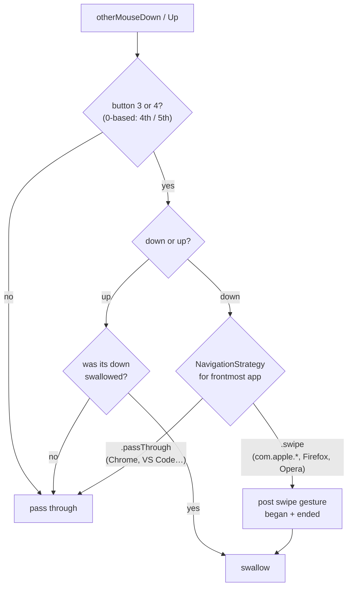
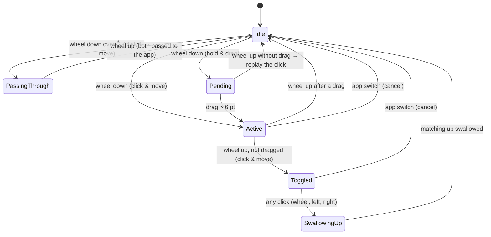
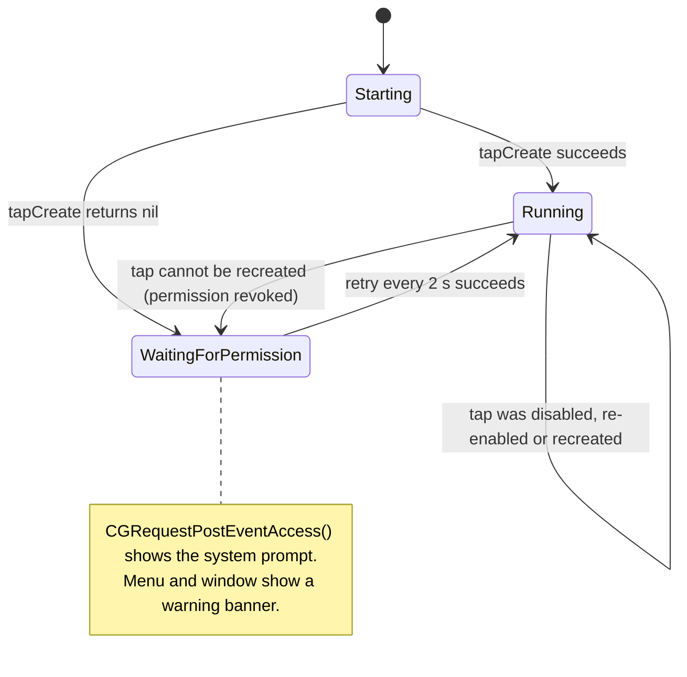
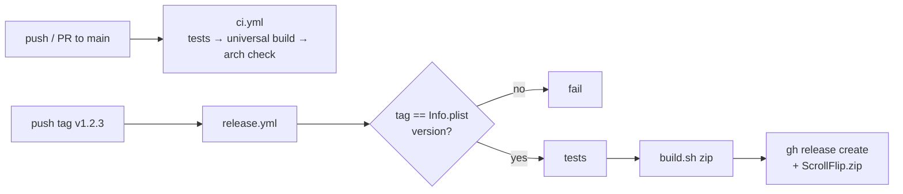

# Architecture

ScrollFlip is a menu-bar AppKit app, and its settings window is SwiftUI. There is no Xcode project and no SwiftPM package. [build.sh](build.sh) compiles everything with `swiftc` once per architecture, merges the results with `lipo`, assembles the `.app` bundle and signs it. The tests are a plain executable built by [scripts/test.sh](scripts/test.sh).

## Project layout

```
Sources/
  Core/                    Logic, no UI. Compiled into both the app and the tests.
    ScrollInverter.swift   CGEventTap: detects mouse-wheel events, reverses and scales them
    SideButtons.swift      Optional tap for buttons 4/5 → Back/Forward (swipe gesture)
    AutoScroll.swift       Optional Windows-style autoscroll state machine + taps
    AppState.swift         Settings (UserDefaults), launch at login, live demo samples
    Localization.swift     Language enum and every UI string (es / en)
  App/                     UI and entry point. Compiled only into the app.
    main.swift             NSApplication in .accessory mode (no Dock icon)
    AppDelegate.swift      Menu bar item, menu, permission flow, health checks, About
    SettingsWindow.swift   SwiftUI window: General · Try it · Language tabs
    AutoScrollUI.swift     Floating anchor overlay, pointing-hand cursor detection
Tests/                     Dependency-free test runner and test suites
Resources/
  Info.plist               LSUIElement, bundle id, version, icon
  ScrollFlip.entitlements  App Sandbox on, no network
  AppIcon.icns / .png      Generated by scripts/make-icon.sh
scripts/
  test.sh                  Build and run the tests
  create-signing-cert.sh   Self-signed certificate for stable local signing
  make-icon.sh / .swift    Draws the icon with AppKit and builds the .icns
.github/workflows/
  ci.yml                   Tests and universal build on every push / PR
  release.yml              On a v* tag: tests, build, zip, GitHub release
build.sh                   Build, bundle, sign, optionally install or zip
```

The split between `Core` and `App` is the boundary for testing. `Core` imports only Foundation, CoreGraphics and ServiceManagement, and everything it depends on can be injected.

## Components



`AppState` is the single source of truth. Every `@Published` setting has a `didSet` that writes to `UserDefaults` and copies the value into `ScrollInverter`. The inverter itself knows nothing about the UI or persistence. `UserDefaults` and the login-item service are injected, so tests can use a throw-away defaults domain and a fake login item.

## Life of a scroll event



### How it tells the mouse from the trackpad

Each scroll event carries `kCGScrollWheelEventIsContinuous`:

| Device | `isContinuous` | ScrollFlip |
|---|---|---|
| Classic mouse wheel | 0 (line-based) | reversed and scaled |
| Trackpad | 1 (pixel-based) | untouched |
| Magic Mouse | 1 | untouched |
| Free-spinning wheels (some Logitech) | sometimes 1 | untouched (known limitation) |

### How an event is modified

Each axis has three delta fields that apps read differently:

| Field | Type | Used by |
|---|---|---|
| `scrollWheelEventDeltaAxisN` | integer lines | legacy / line-based apps |
| `scrollWheelEventFixedPtDeltaAxisN` | fixed-point lines | `NSEvent.deltaY` |
| `scrollWheelEventPointDeltaAxisN` | integer pixels | pixel-based scrolling |

`ScrollInverter.scale` first reads all three fields, then writes them all multiplied by the factor. Writing one field can make the system recompute the others, which is why the reads come first. The integer fields go through `scaled()`, which rounds but never turns a real movement into 0. Otherwise slow speeds would swallow notches.

When the factor is exactly 1 (not reversed, default speed), the event is not touched at all.

## Side buttons → Back / Forward

Simulating `⌘[` / `⌘]` breaks on non-US keyboard layouts, where `[` and `]` are not on the same keys. Instead, ScrollFlip follows the approach of LinearMouse and Mac Mouse Fix: it chooses a strategy per frontmost app.



- **Separate tap.** `SideButtonMapper` has its own event tap with a mask of only `otherMouseDown | otherMouseUp`. It exists only while the option is on and the permission is granted (`AppState.applySideButtons()`). With the option off, the process receives no button events at all.
- **Pure decision logic.** The logic is in `decide(button:isDown:bundleID:)`. The frontmost app and the action are injected closures, so the tests drive it without AppKit or real events.
- **The swipe gesture.** A gesture event (type 29) with the undocumented fields 110 = 16 (navigation swipe), 132 = phase (1 began, 4 ended) and 115 = direction (4 left = Back, 8 right = Forward, only on the ended event). It is posted to the HID event tap. These are the values SensibleSideButtons uses.
- **Testing without side buttons.** `simulateClick(_:)` posts a synthetic button 4/5 click at the pointer. It goes through the same tap and the same logic as a physical button. The *Try it* tab uses it after a 3-second countdown, which gives you time to switch to Safari or Finder.

## Autoscroll (wheel click)

On Windows, autoscroll is implemented **inside each app**. The browser knows whether a link is under the pointer, so it can decide between "open in new tab" and "autoscroll". ScrollFlip lives outside the apps, so it uses the only signal that needs no access to their content: **the cursor's shape**. `CursorProbe` compares `NSCursor.currentSystem` with `NSCursor.pointingHand` (image data, or the relative hot spot and aspect ratio for enlarged cursors).

`AutoScroller` is a pure state machine. The pointer position, cursor check, event posting and overlay are injected closures.



While *Active* or *Toggled*, a 60 Hz timer:

1. reads the pointer position;
2. computes a speed per axis with `velocity(offset:)`, which has a 10 pt dead zone, grows as `1.8 · d^1.4` and is capped at 6000 px/s;
3. accumulates the fractional pixels, so slow speeds aren't lost;
4. posts pixel scroll events.

Pointer below or right of the anchor scrolls down or right. Synthetic events are not affected by "natural scrolling", so the direction is always the Windows one.

### Taps and synthetic events

| Tap | Mask | Exists |
|---|---|---|
| Middle button | `otherMouseDown / Dragged / Up` (button 2 only is acted on) | while autoscroll is enabled |
| Exit clicks | `left/rightMouseDown / Up` | only while toggled autoscroll is running |

Every event ScrollFlip posts itself (autoscroll ticks, replayed wheel clicks) carries `eventSourceUserData = "SCRL"` (`SyntheticEvent.marker`). The scroll and middle-button taps ignore marked events, so ScrollFlip never reverses its own autoscroll and never re-captures a click it replayed.

## Permission and self-healing



`ScrollInverter.ensureRunning()` is the health check. In order:

1. If the tap exists and is enabled, there is nothing to do.
2. If the tap exists but macOS disabled it, it re-enables it.
3. If that doesn't work, it destroys the tap and creates a new one.
4. If creation fails, the Accessibility permission was revoked. The app goes back to *waiting for permission*.

The callback also re-enables the tap as soon as macOS reports `tapDisabledByTimeout` or `tapDisabledByUserInput`.

### Code signing and the permission

macOS grants Accessibility to a **code signature**, not to a file path:

| Signing | Designated requirement | Permission after a rebuild |
|---|---|---|
| Ad-hoc (`codesign -s -`) | `cdhash H"…"` (hash of this exact binary) | lost |
| Local certificate (`create-signing-cert.sh`) | `identifier "dev.local.ScrollFlip" and certificate leaf = H"…"` | kept |

Release builds made by CI are ad-hoc signed. This is fine for end users, who don't rebuild. After updating to a new release they reset and grant the permission once more.

## Threading

The tap's run-loop source is added to the **main** run loop. The tap callback, the UI, the timers and `AppState` therefore all run on the main thread, so no locks are needed. The callback is a global C function; it gets the `ScrollInverter` instance through `userInfo` with `Unmanaged.passUnretained`.

## Localization

`Localization.swift` defines a `Language` enum (`system`, `es`, `en`) and an `L` enum (`CaseIterable`) with one case per string, each holding a `(spanish, english)` pair. `AppState.t(_:)` resolves the current language. Because `language` is `@Published`, the SwiftUI window re-renders immediately. The menu is rebuilt every time it opens, so it picks up the change too. A test checks that every string exists in both languages. To add a language, add a case to `Language` and a column to the table.

## Testing

XCTest is not shipped with the Command Line Tools, and the project deliberately has no SwiftPM package. Instead, `scripts/test.sh` compiles `Sources/Core` together with `Tests/` into one executable. `Tests/TestKit.swift` is a 50-line runner providing `suite`, `test`, `expect` and `expectEqual`. The process exits with code 1 if any test fails, which is what CI checks.

The key trick is that `CGEvent(scrollWheelEvent2Source:…)` creates real scroll events **without any permission**. The same applies to gesture events. The tests feed them straight to `ScrollInverter.process(_:)` and inspect the delta fields afterwards.

| Suite | What it covers |
|---|---|
| ScrollInverter | reversal on all three fields, trackpad untouched, disabled / default no-ops, horizontal axis, speed scaling, rounding never yields 0, demo observer |
| SideButtons | per-app strategy, button mapping and swap, swallowing the matching button-up, pass-through for other buttons and apps, swipe event fields |
| AutoScroll | velocity curve and dead zone, both modes, link pass-through, click replay, stop by any click with swallowed ups, direction on both axes, fractional accumulation, cancel, synthetic-event marker |
| AppState | defaults, side-button tap never started without permission, settings pushed to the inverter, persistence across relaunch, corrupted values, first-launch flag, launch-at-login success and failure, demo samples |
| Localization | every string in both languages, language resolution, stable persisted raw values |

## CI and releases



Both workflows run on `macos-15` GitHub runners. Release builds are ad-hoc signed and not notarized. Notarization requires a paid Apple Developer account, so users approve the app once in *Privacy & Security*, as the release notes explain.

## Security & privacy

| Measure | Effect |
|---|---|
| Event mask = `scrollWheel` only | The process never receives keys, clicks or pointer movement. |
| Autoscroll taps are opt-in | The middle-button tap exists only while autoscroll is on. The left/right-click tap and pointer polling run only while autoscroll is actively scrolling. The link check reads the cursor shape only. |
| Side-button tap is opt-in | Only `otherMouseDown/Up`, created only while the option is on. Left/right clicks are never seen. |
| `app-sandbox`, no `network.client` | The OS blocks all network connections. The About link opens in the user's browser, not in the app. |
| No third-party code | Only Apple frameworks: AppKit, SwiftUI, Combine, CoreGraphics, ServiceManagement. |
| No event persistence | Only five preferences go to `UserDefaults`. Demo samples live in memory while the window is open. |
| Hardened runtime | Enabled at signing time (`--options runtime`). |

## Possible next steps

- Identify the device with `IOHIDManager`, to support free-spinning wheels that send continuous events.
- Smooth scrolling (interpolate wheel notches into pixel events).
- Developer ID signing and notarization, to remove the Gatekeeper step.
