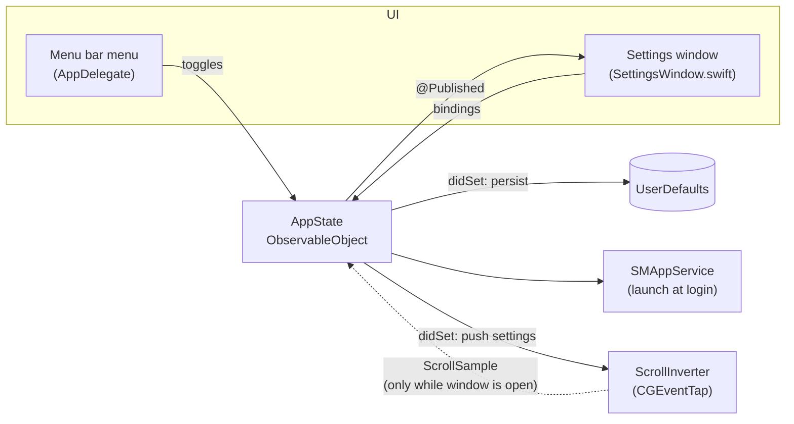
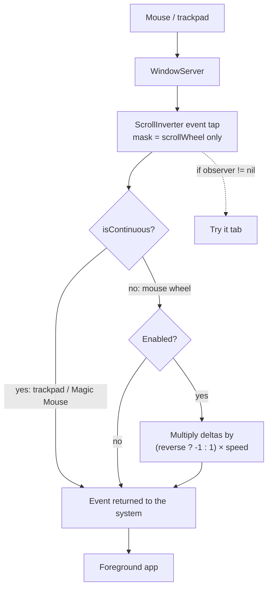
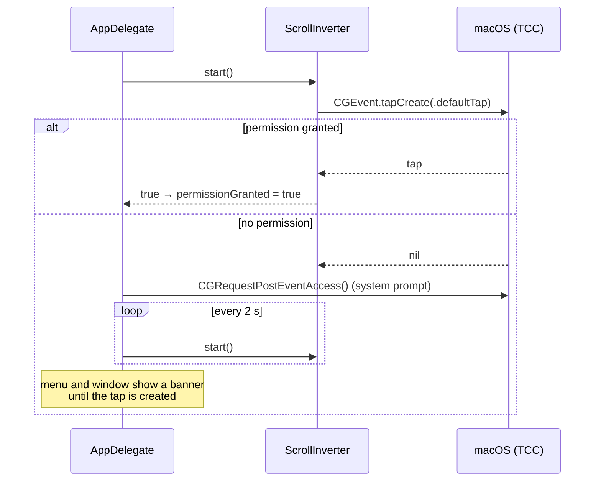

# Architecture

ScrollFlip is a menu-bar AppKit app, and its settings window is SwiftUI. There is no Xcode project: [build.sh](build.sh) compiles everything with `swiftc`, assembles the `.app` bundle and signs it.

## Project layout

```
Sources/
  main.swift             Entry point: NSApplication in .accessory mode (no Dock icon)
  AppDelegate.swift      Menu bar item, menu, permission polling, settings window
  AppState.swift         Settings (UserDefaults), launch at login, live demo samples
  ScrollInverter.swift   CGEventTap: detects mouse-wheel events, reverses and scales them
  SettingsWindow.swift   SwiftUI window: General · Try it · Language tabs
  Localization.swift     Language enum and every UI string (es / en)
Resources/
  Info.plist             LSUIElement, bundle id, minimum macOS
  ScrollFlip.entitlements  App Sandbox on, no network
scripts/
  create-signing-cert.sh Self-signed certificate for stable code signing
build.sh                 Build, bundle, sign, optionally install
```

## Components



`AppState` is the single source of truth. Every `@Published` setting has a `didSet` that writes to `UserDefaults` and copies the value into `ScrollInverter`. The inverter itself knows nothing about the UI or persistence.

## Life of a scroll event



### How it tells the mouse from the trackpad

Each scroll event carries `kCGScrollWheelEventIsContinuous`:

| Device | `isContinuous` | ScrollFlip |
|---|---|---|
| Classic mouse wheel | 0 (line-based) | reversed and scaled |
| Trackpad | 1 (pixel-based) | untouched |
| Magic Mouse | 1 | untouched |
| Free-spinning wheels (some Logitech) | sometimes 1 | untouched (known limitation) |

### How an event is modified

Each axis has three delta fields that apps read differently:

| Field | Type | Used by |
|---|---|---|
| `scrollWheelEventDeltaAxisN` | integer lines | legacy / line-based apps |
| `scrollWheelEventFixedPtDeltaAxisN` | fixed-point lines | `NSEvent.deltaY` |
| `scrollWheelEventPointDeltaAxisN` | integer pixels | pixel-based scrolling |

`ScrollInverter.scale` first reads all three fields, then writes them all multiplied by the factor. Writing one field can make the system recompute the others, which is why the reads come first. The integer fields are rounded, but a non-zero movement never becomes 0. Otherwise slow speeds would swallow notches.

When the factor is exactly 1 (not reversed, default speed), the event is not touched at all.

## Permission flow



macOS grants Accessibility to a **code signature**, not to a file path. An ad-hoc signature (`codesign -s -`) produces a designated requirement based on the binary hash, so every rebuild is a "new" app. `scripts/create-signing-cert.sh` creates a self-signed certificate. With it, the designated requirement becomes `identifier "dev.local.ScrollFlip" and certificate leaf = H"…"`, which stays the same across builds.

## Threading

The tap's run-loop source is added to the **main** run loop. The tap callback, the UI and `AppState` therefore all run on the main thread, so no locks are needed. The callback is a global C function; it gets the `ScrollInverter` instance through `userInfo` with `Unmanaged.passUnretained`. If macOS disables the tap (`tapDisabledByTimeout` / `tapDisabledByUserInput`), the callback re-enables it.

## Localization

`Localization.swift` defines a `Language` enum (`system`, `es`, `en`) and an `L` enum with one case per string, each holding a `(spanish, english)` pair. `AppState.t(_:)` resolves the current language. Because `language` is `@Published`, the SwiftUI window re-renders immediately. The menu is rebuilt every time it opens, so it picks up the change too. To add a language, add a case to `Language` and a column to the table.

## Security & privacy

| Measure | Effect |
|---|---|
| Event mask = `scrollWheel` only | The process never receives keys, clicks or pointer movement. |
| `app-sandbox`, no `network.client` | The OS blocks all network connections. |
| No third-party code | Only Apple frameworks: AppKit, SwiftUI, Combine, CoreGraphics, ServiceManagement. |
| No event persistence | Only five preferences go to `UserDefaults`. Demo samples live in memory while the window is open. |
| Hardened runtime | Enabled at signing time (`--options runtime`). |

## Possible next steps

- Identify the device with `IOHIDManager`, to support free-spinning wheels that send continuous events.
- Map mouse buttons 4/5 to back/forward.
- Smooth scrolling (interpolate wheel notches into pixel events).
- Universal binary (x86_64 + arm64), plus a Developer ID signature and notarization for distributing prebuilt releases.
