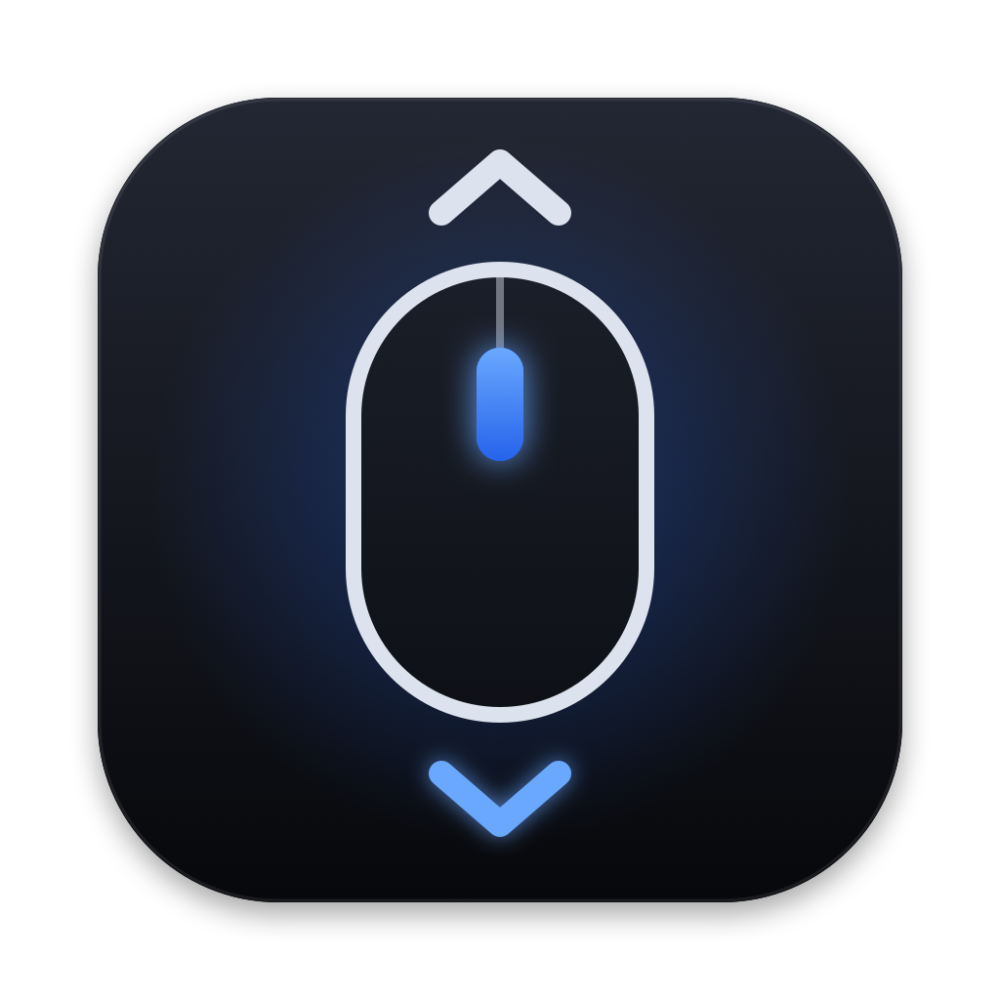

<p align="center">
  
</p>

<h1 align="center">ScrollFlip</h1>

<p align="center">
  Reverse the <b>mouse</b> scroll wheel on macOS without touching the <b>trackpad</b>.
</p>

<p align="center">
  <a href="https://github.com/AlbertoGonzalezCasarrubios/ScrollFlip/actions/workflows/ci.yml"></a>
  <a href="https://github.com/AlbertoGonzalezCasarrubios/ScrollFlip/releases/latest"></a>
  
  <a href="LICENSE"></a>
</p>

---

macOS has a single "Natural scrolling" switch, and it applies to both the trackpad and the mouse. If you want natural scrolling on the trackpad and classic, Windows-style scrolling on the mouse wheel, ScrollFlip does exactly that, and nothing else.

## Features

- **Mouse only.** The trackpad and the Magic Mouse keep the system behaviour.
- **Adjustable wheel speed**, from 0.5× to 4×, with the system speed as the default.
- **Optional Back / Forward on side buttons 4 and 5**, off by default. It works in Safari and Finder, and you can test it without side buttons.
- **Optional Windows-style autoscroll**, off by default. Click the wheel and move the mouse to scroll; a wheel click on a link still opens it in a new tab.
- **"Try it" tab** that shows live what happens to each scroll event.
- **English and Spanish UI**, switchable at any time.
- **Self-healing.** If macOS disables it (after sleep, a user switch, or a revoked permission), it recovers or tells you.
- **Lives in the menu bar**, with no Dock icon. It can open at login.
- **Universal binary** for Apple Silicon and Intel.

### Privacy by design

- It only listens to scroll-wheel events. It never sees keystrokes, left/right clicks or pointer movement. If you turn on the side-button or autoscroll options, it also receives clicks from the *extra* mouse buttons (side buttons, wheel click), and only while those options are on.
- It is sandboxed, with **no network entitlement**, so it cannot connect to the internet.
- It never stores or logs events.
- It has no third-party dependencies.

## Install

### Download

1. Download **ScrollFlip.zip** from the [latest release](https://github.com/AlbertoGonzalezCasarrubios/ScrollFlip/releases/latest), unzip it and move **ScrollFlip.app** to `/Applications`.
2. Open it. The app is not notarized by Apple, so macOS will refuse to open it the first time. Go to **System Settings → Privacy & Security**, scroll down and click **Open Anyway**.
3. Grant **Accessibility** permission when asked. ScrollFlip starts working immediately.

### Build from source

You need macOS 13 or later and Xcode or just the Command Line Tools (`xcode-select --install`).

```bash
git clone https://github.com/AlbertoGonzalezCasarrubios/ScrollFlip.git
cd ScrollFlip
scripts/create-signing-cert.sh   # once: creates a local signing certificate
./build.sh install               # builds, copies to /Applications and launches
```

The first time you build, macOS may ask whether `codesign` can use the new certificate. Enter your login password and choose **Always Allow**.

<details>
<summary>Why a signing certificate?</summary>

macOS ties the Accessibility permission to the app's code signature. With ad-hoc signing, every rebuild has a different signature, so the permission silently stops applying. The toggle still shows "on", but the app gets nothing.

`create-signing-cert.sh` creates a self-signed certificate in your login keychain. `build.sh` then uses it automatically, so the permission survives rebuilds. The certificate is only used locally, and you can delete it from Keychain Access at any time.
</details>

## Usage

Click the mouse icon in the menu bar:

| Item | What it does |
|---|---|
| Settings & demo… | Opens the settings window (General · Try it · Language). |
| Enabled | Pauses or resumes ScrollFlip. |
| Reverse vertical / horizontal | Chooses which axes are reversed for the mouse. |
| Open at login | Starts ScrollFlip automatically when you log in. |
| About ScrollFlip | Shows the version, license and project link. |

The settings window has three tabs:

- **General**: on/off, reversed axes, wheel speed (0.5× to 4×, with a *Reset* button back to the default 1×), side buttons, autoscroll and launch at login.
- **Try it**: scroll with the mouse and with the trackpad to see the original event, the event apps receive, and whether it was reversed. You can also fire a simulated side-button click, so you can check Back/Forward without a mouse that has side buttons, try autoscroll on the list of rows, and see live whether the link cursor is detected.
- **Language**: system default, English or Spanish.

### Side buttons (Back / Forward)

Turn on **Buttons 4 and 5: Back / Forward** in *General*. It works per app:

| App | What ScrollFlip does |
|---|---|
| Safari, Finder, Preview and other Apple apps, Firefox, Opera | Simulates the trackpad's *swipe between pages* gesture. It doesn't depend on the keyboard layout. |
| Chrome, Edge, Arc, VS Code and others | Leaves the button alone, because these apps already map buttons 4/5 to Back/Forward. |

*Swap buttons* exchanges Back and Forward, for mice that label them the other way round.

### Autoscroll (wheel click)

Turn on **Enable autoscroll** in *General* and choose a mode:

| Mode | How it works | Wheel click on a link |
|---|---|---|
| **Click and move** (default, like Windows) | Click the wheel, then move the mouse: the farther from the anchor, the faster it scrolls, in any direction. Any click stops it. Holding the wheel and dragging also works. | Opens the link in a new tab, as usual. |
| **Hold and drag** | Hold the wheel and drag. Releasing it stops. | Works everywhere, because a click without a drag is passed on unchanged. |

A small anchor icon marks where you started. Switching apps also stops autoscroll.

**How links are detected.** ScrollFlip has no access to the page, so it looks at the cursor's shape. If it is the pointing hand 👆, the wheel click goes through normally. This is also why, in *Click and move* mode, middle-clicking a browser tab to close it no longer works: over a tab the cursor is a normal arrow. Use *Hold and drag* if you rely on that.

### Natural scrolling

Set "Natural scrolling" in System Settings to whatever you like for the trackpad. ScrollFlip only fixes the mouse. All settings are saved immediately and restored on the next launch.

> If you run another app that does the same thing (Scroll Reverser, Mos, LinearMouse, Mouse Glide…), quit it. If both reverse the wheel, they cancel each other out.

## Troubleshooting

**It asks for Accessibility and nothing happens.** The permission is probably attached to an older build. Reset it and relaunch:

```bash
tccutil reset Accessibility dev.local.ScrollFlip
open /Applications/ScrollFlip.app
```

Then grant the permission again. If you build from source and `build.sh` printed "signing ad-hoc", run `scripts/create-signing-cert.sh` first.

**`build.sh` fails with `errSecInternalComponent` or "Operation timed out".** `codesign` is waiting for permission to use the certificate. Run `./build.sh` from Terminal and click **Always Allow** in the keychain prompt.

## Known limitations

- **Free-spinning "smooth" wheels** (some Logitech MX mice) can send continuous events, like a trackpad. ScrollFlip leaves them unchanged.
- **The Magic Mouse is treated as a trackpad**, because it also sends continuous events. This is usually what you want.
- **Back/Forward does not work in a few Apple apps** that ignore the swipe gesture, such as System Settings and the App Store. It also does nothing in apps that understand neither the gesture nor buttons 4/5.
- **The swipe gesture uses undocumented event fields**, the same ones LinearMouse, Mac Mouse Fix and SensibleSideButtons use. A future macOS could change them.
- **Autoscroll scrolls the window under the pointer.** If you move the pointer far outside the window you started in, another window may scroll.
- **Autoscroll cannot change the system cursor**, as Windows does. The floating anchor icon is shown instead.
- **Speeds below 1×** are fully smooth in apps that use pixel deltas, which covers most modern apps. Apps that only read whole lines still move at least one line per notch.

## Development

```bash
scripts/test.sh        # unit tests (no permissions needed)
./build.sh             # universal build in build/ScrollFlip.app
./build.sh zip         # same, plus build/ScrollFlip.zip
scripts/make-icon.sh   # regenerate Resources/AppIcon.icns
```

CI runs the tests and a universal build on every push. To publish a release, bump `CFBundleShortVersionString` in `Resources/Info.plist`, add a matching section to [CHANGELOG.md](CHANGELOG.md), then push a matching tag:

```bash
git tag v1.0.1 && git push origin v1.0.1
```

See [ARCHITECTURE.md](ARCHITECTURE.md) for how it works.

## Verify the privacy claims yourself

```bash
codesign -d --entitlements - /Applications/ScrollFlip.app
```

The only entitlement listed should be `com.apple.security.app-sandbox`. Without `com.apple.security.network.client`, the system blocks every outgoing connection.

## Uninstall

1. Menu → Quit ScrollFlip.
2. Delete `/Applications/ScrollFlip.app`.
3. Run `tccutil reset Accessibility dev.local.ScrollFlip`.
4. Optionally, delete the "ScrollFlip Local Signing" certificate in Keychain Access.

## License

[MIT](LICENSE) © 2026 Alberto González-Casarrubios
